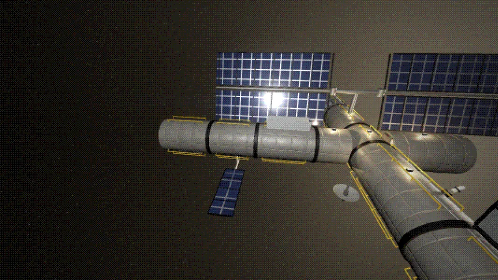
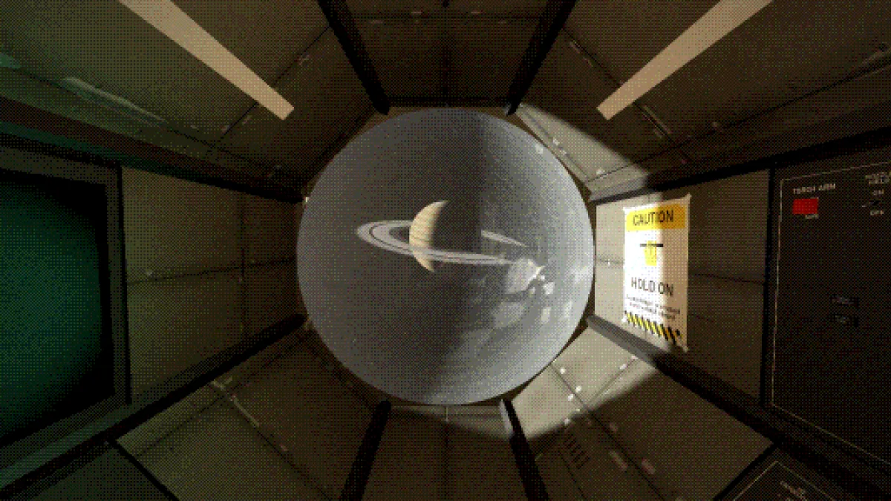
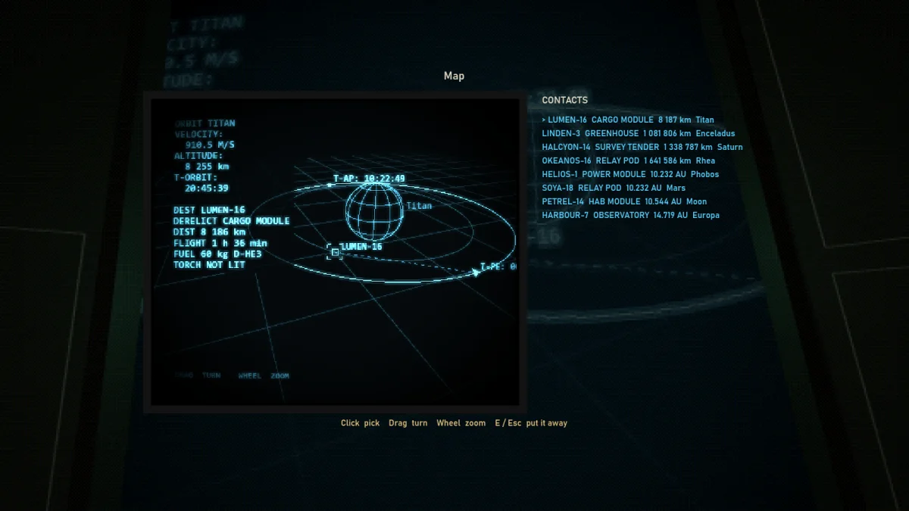
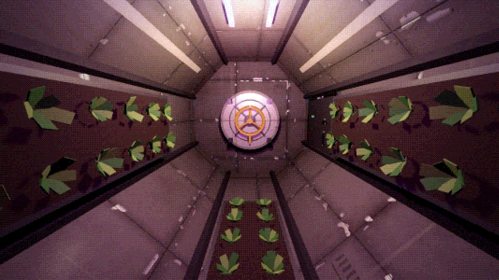
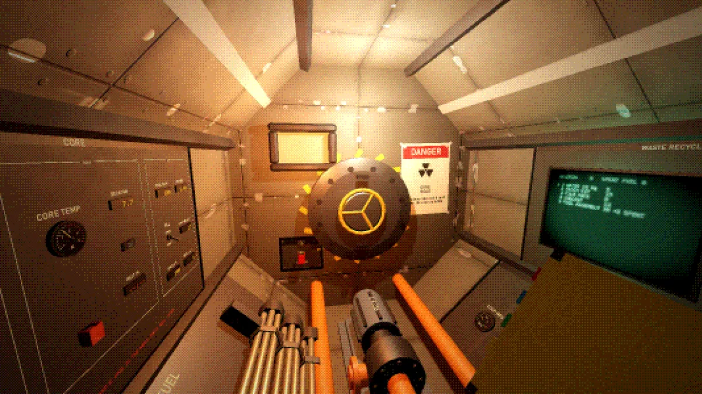

# Lantern

You are the last person aboard **Lantern**, a research station-ship in orbit round Saturn.
The crew has gone home; you stayed. There is no station computer to talk you through
anything: only the station, its panels, and a slow text link to the Office back home, which
buys what you discover and sends supplies by drone while a relay can hear you.

Run the whole station by hand: a fission reactor in its own module (refuelled by hand, one
assembly at a time), two power buses, radiators, life support, a nuclear main engine and a
fusion torch, all on physical panels of switches, covers, breakers, knobs, levers and
valves. Fly it round the real Solar System and, past it, to star systems generated without
end. Dock derelicts and strip them; dock whole modules and keep them. Stay alive while you
do it.

A zero-G survival game in Godot 4.3. The station, its materials, the sky, the planets, every
sound effect and the music are made in code.

**Download:** [Lantern.exe](https://github.com/KosmmoSttars/lantern/releases/latest) (Windows,
one file, nothing to install).

| | |
| --- | --- |
|  |  |
|  |  |

## Moving

There is no walking and no thruster pack. **Hold LMB on any surface** and your arm pulls you
in to it; let go on the way and you fly on with that speed. **RMB** while holding on pushes
off where you look. The view turns round the station's up and never rolls.

| Keyboard / mouse | Action |
| --- | --- |
| Mouse | look |
| Hold LMB on a surface | pulled in to it; let go to fly on |
| RMB while holding on | push off where you look (hold to push harder) |
| Wheel while holding on | hang closer to the grip, or farther |
| LMB on a control | use it: switch, press, push a breaker, lift a cover |
| Hold LMB on a job | turn a hatch wheel, patch a breach, unpack a crate |
| Wheel on a control | turn a knob, a selector, a lever, a valve |
| E on a screen | see it full size (the map works there with the mouse); E or Esc puts it away |
| E | use what you hold (the instant camera: take a photo) |
| F | the flashlight |
| Q | the other hand and the pocket |
| R (hold) | haul yourself back along the umbilical outside |
| Esc | menu |

All keys can be rebound (Settings > Controls). English and Russian (Settings > Game).

## Flying

The map is set into the command deck's floor. Press E on it, click a planet or moon: the map
centres on it and the wheel zooms in on it. The nav screen under it then ticks off the
fusion torch's steps live: TORCH ARM, NOZZLE FIELD (about 40 seconds), IGNITE, throttle
full, ENGAGE. The station turns, burns and brakes into orbit round the target by itself:
a minute to forty minutes within a system. The torch burns D-He3, bought from the Office or
taken from fuel depots.

Wheel the map out past the edge of the system for the star map. Only the systems you have
been to are charted; the rest is fog. The nearest pulsar shows through it as radio pulses,
and its timing (Star Navigation panel) lets the computer plot crossings past ten light
years. A crossing takes twenty to forty minutes.

There is no time warp: one second of play is one minute of the keeper's day. Sleep is the
only way to make the hours go faster.

## Salvage and modules

Derelict modules ride round some planets and moons; beside the map seen full size, CONTACTS
lists the ones in the system. Fly to one, then DOCK on the DOCKING PORT panel off the Node:
it comes in to the port. It is airless: PRESSURIZE it until EQUAL lights and the port hatch
will open. Inside, by torchlight, take what its crew left. Shut the hatch and UNDOCK.

Whole modules wait in orbit too: a greenhouse round Enceladus (food every two hours), an
observatory round Europa (every scan worth half as much again), a power module round Phobos
(more battery, more solar). Dock one and it is part of the station for good, its far hatch
the port for the next.

## Staying alive

Eat and drink at the galley; sleep in the bag; mind the radiation (Jupiter's belts kill in
minutes, solar flares give you a minute to reach the shelter in Life support). Breathing is a
given and life support makes up the air that leaks, but a micrometeoroid's hole bleeds the
station's warmth away until it is patched, and the hit often shorts the gear beside it.
Outside, clip the umbilical on at its reel in the airlock first: the outer hatch has no
interlock.

The reactor has a manual of its own (the yellow book in its module). It can melt down, and
there are four careless ways to blow it up.

## Building and checks

- **Play from source:** open the folder in Godot 4.3.
- **Build:** `tools\build.bat` makes `build\Lantern.exe`, the game in one file (set `GODOT`
  and `GODOT_CONSOLE` if Godot 4.3 is not in `%LOCALAPPDATA%\Programs\Godot`).
- **Checks:** `godot --path . -- --selftest` works every control on every panel, the
  movement, the map and transits, a trip to the nearest star, the body, science and supply,
  the airlock and a spacewalk, docking, the reactor and more; exit code 0 when all pass.
  `--only sleep,body` runs the sections named; `--lang ru` runs them in Russian; `--shots`
  saves screenshots. Headless sim checks: `godot --headless --path . -s tools/simcheck.gd`
  (also `rxcheck`, `burncheck`, `flightcheck`).
- **Russian:** the tables in `tools/ru/*.tsv`, built into `scripts/loc_ru.gd` by
  `python tools/build_loc.py` (`--missing` lists what is not translated yet).

`DESIGN.md` has the whole design.

## License

MIT, see [LICENSE](LICENSE).
